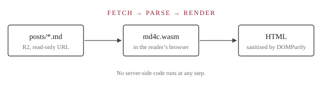

This blog has four layers, shown below from storage to screen.



## MD4C as WebAssembly

The C parser and HTML renderer from `src/` are compiled with plain
`clang --target=wasm32`. A tiny freestanding libc (`wasm/libc/`) supplies
`malloc`, `memcpy`, `snprintf` and friends, so neither Emscripten nor a WASI
SDK is needed. The module is about 130 KB and exports one real function:

```c
int md4c_wasm_to_html(const char* input, unsigned input_size,
                      unsigned parser_flags, unsigned renderer_flags);
```

## A file system made of storagesdk

The native `md2html` reads and writes files with stdio. A browser has no
files, so `wasm/js/md4c-fs.js` provides `readFile`, `readdir`, `renderFile`
and friends on top of [storagesdk](https://github.com/storagesdk/storagesdk).
In the browser it uses a read-only adapter that fetches files from a plain
public URL, such as a Cloudflare R2 bucket.

| Path              | Contents                                 |
|-------------------|------------------------------------------|
| `index.json`      | the list of posts, with title/date/tags  |
| `posts/<slug>.md` | Markdown source with front matter        |

## Read-only for everyone but the owner

Visitors only ever see the bucket's public URL, which accepts reads and
nothing else. The owner publishes from their own machine with
`scripts/publish.mjs`, which writes through any storagesdk adapter (R2, S3,
a local folder, ...) using credentials only they have. Rendered HTML is
also cleaned by DOMPurify, under a strict Content-Security-Policy.

## The blog itself

A few hundred lines of plain JavaScript: a hash router, a post list and a
post view. Its appearance — title, slogan, theme, colours, background image
— is configured in the `site` section of `index.json`.[^speed]

[^speed]: Every post is rendered when you open it. MD4C is fast enough that
    this usually takes well under a millisecond.
